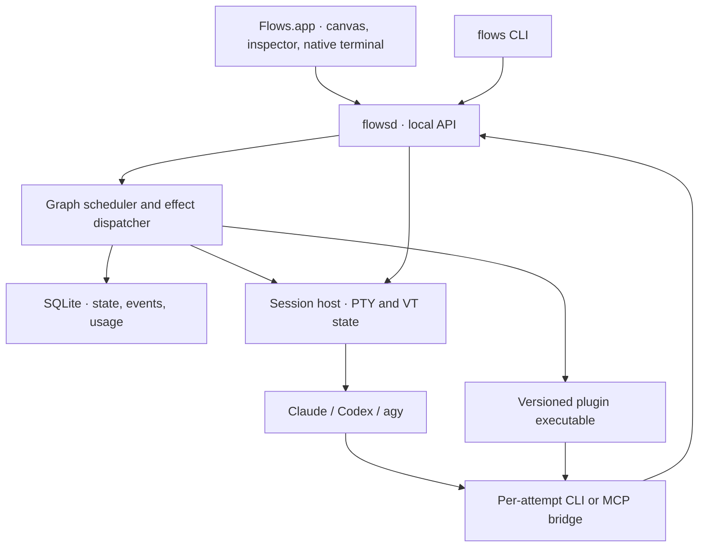

# Flows architecture

This document describes the intended macOS product. The implementation plan breaks it into independently verifiable changes. The first release runs entirely under the signed-in user. Flows.app and the CLI connect to one local Go daemon. All runs share one execution canvas. The template editor opens a separate view of a saved definition.

## Process and technology choices

| Layer | Choice | Implementation consequence |
|---|---|---|
| Desktop | Svelte workspace in a Wails v2 window | The canvas, node inspector, terminal preview, settings and analytics share the bundled Catppuccin Mocha 2 scheme. The Go bridge connects to flowsd over its private Unix socket. |
| Terminal | Pinned native Ghostty macOS embedder for display and libghostty-vt for host-side terminal state | The host must run without a window. The desktop surface displays an attached session. Prove the native attach/replay path on real interactive CLIs before building the rest of the UI. The public VT library exposes emulator state. The native surface API is an internal upstream interface and needs a pinned bridge. [Public VT API](https://lib.ghostty.org/vt/index.html) · [Native embedder header](https://github.com/ghostty-org/ghostty/blob/main/include/ghostty.h) |
| Service and clients | Go standard library, net/http over a private Unix socket, JSON requests, SSE for workspace events, binary WebSocket frames for terminal attachment | All clients reuse the same API and reconnect logic. OS paths and host handles remain local to the daemon. The CLI and native relay both upgrade HTTP/1.1 GET /v1/sessions/{id}/attach to WebSocket over the Unix socket. |
| Process host | Detached Go helper, process group, github.com/creack/pty, native VT bindings through cgo | One host per interactive session. CLI, app, or daemon restart can reconnect by stable identity. [PTY package](https://pkg.go.dev/github.com/creack/pty) |
| Durable state | database/sql with modernc.org/sqlite, WAL, foreign keys, one serialized writer | Commit state, event sequence and effect intent together. Bulk terminal output and artifacts go in private files. [SQLite Go driver](https://pkg.go.dev/modernc.org/sqlite) |
| Definitions | Versioned YAML syntax tree, JSON Schema for manifests and value types, a small typed binding evaluator, Go text/template for prompts | Preserve editable YAML, reject invalid edges before running, and pin definition, prompt and operation revisions. No shell evaluation of input values. |
| Scheduling | robfig/cron/v3 for calendar expressions plus a durable SQLite occurrence queue | Specify time zone, overlap behavior, catch-up policy and unique occurrence key. Timer wakeups, daemon restarts and laptops waking from sleep all reconcile the same queue. |
| Extensions | Go SDK in its own module, independently built plugin executables, versioned JSON frames over stdio | A plugin exports many operations and optional templates/workflows. Compile on installation. Node execution and direct harness calls invoke the same registered implementation. |
| System integration | launchd per-user LaunchAgent, Keychain references or provider CLI credential stores, UserNotifications, versioned application bundles, GNU/BSD-compatible Make recipes using a pinned toolchain | A GUI launch does not inherit the interactive shell environment. Configure executable paths and show resolved versions in Settings. |

### Runtime topology

For a new session, commit the root, attempt, request key and launch intent in one transaction. Start the host after commit. A per-attempt startup lock guards child creation, and durable host identity and exit receipts allow the daemon to adopt an existing launch when registration was interrupted.

At startup the daemon resolves its home, takes the per-home lock, migrates the database, loads the last valid catalog, adopts hosts and reconciles persisted launch intents. Only then does it dispatch ready work. Clients get a snapshot and cursor, subscribe to subsequent events, ignore duplicate sequence numbers and fetch a new snapshot after a replay gap. Slow clients can reconnect without delaying commits. API errors carry a stable code, message, optional field/path and current revision for conflicts.

### Recovery across process boundaries

A restart of a peer is an expected operating condition. A component acknowledges durable work only after the data needed to resume is on disk. Keep independent processes running where possible. After reconnection, identify previous work by stable IDs and reconcile the last committed outcome before dispatching more. Apply this rule to the app event cursor, host adoption, plugin effect receipts and harness completions.

For a completion, the harness bridge submits the attempt ID, a stable event ID and payload to its session host. The host authenticates the submission, validates the payload against the attempt’s local pinned result contract and durably records a valid submission in a private per-attempt outbox, including any required artifact references whose contents are already durable. It can now return a receipt marked **saved locally** and the harness can exit. The daemon validates the submission against the pinned run and current attempt, then commits the outcome, deduplication record and resulting state transition together. It acknowledges only after commit. Redelivery of the same event and payload returns the recorded outcome. A reused ID with different content is a conflict.

Recover pending records from disk even after the host exits. Before classifying an exited host as interrupted, reconcile its pending completion with the run. A cancelled or superseded attempt retains its receipt in history. An invalid completion carries a visible diagnostic. Only an accepted completion releases dependent work. Interactive commands that require an immediate scheduler decision return a retryable connection error during an outage; their request IDs remain stable across retries.

### Chat access after host loss

Open chat on a canvas node reattaches to its live terminal when the host survives. If the host dies, the same action opens the saved conversation immediately. Persist the harness name, native conversation ID and transcript locator as soon as available, plus a private readable history of observed user and assistant turns across attempts. For an adapter without structured turns, retain readable terminal output incrementally and label the coverage. Strip control sequences and exclude hidden input. Recovery must work before a clean process exit.

After reconciling the attempt outcome and checkout ownership, offer Continue chat in a fresh native terminal using the recorded conversation ID. If the installed harness cannot resume that conversation, keep its history readable and offer an explicitly linked new chat with recovered context. Record a new session identity. Opening history has no scheduling or repository side effects.

A host crash leaves the checkout lease unresolved. Record the process group and process birth identity before the writer starts work. Before reusing the checkout, verify the previous writer and its managed descendants have stopped. If ownership is uncertain, show Needs attention, retain the checkout and keep Open chat available. Reconcile outstanding external actions before any workflow retry, including a retry in an isolated checkout.

## User files, imports and ownership

A user can back up, share or edit the workflow and tool library as ordinary files. The following are the defaults on macOS. FLOWS_HOME redirects the whole installation's writable roots to an isolated test or development home. Explicit CLI location options override that base for the current process and propagate to its helpers.

| Default | Owner and contents |
|---|---|
| `$XDG_CONFIG_HOME/flows` or `~/.config/flows` | User configuration. `settings.yaml` holds profiles, external search roots, enablement, preferred executables and policy defaults. `ghostty.conf` holds terminal appearance. |
| `~/.config/flows/workflows/<id>/` | User-owned imported definitions, sibling prompts and assets. The editor shows source path and revision. |
| `~/.config/flows/tools/<id>/` | User-owned plugin source, manifest, module locks, templates and packaged workflow definitions. Settings can add external directories. |
| `~/Library/Application Support/Flows/` | Daemon-owned database, immutable package snapshots, pinned executable revisions, session artifacts, durable worktrees and UI layout preferences. A cache purge cannot break an active run. |
| `~/Library/Caches/Flows/` | Rebuildable downloads, compilation scratch and repository mirrors. Dirty worktrees and pinned run inputs live in durable storage. |
| `~/Library/Logs/Flows/` | Rotated daemon, launcher and plugin build diagnostics. Diagnostic exports exclude credential values. |
| private runtime directory | Lock and short Unix-socket names. Derive a short per-user, per-home directory in the OS runtime/temp root. Verify ownership and 0700 before use, sockets 0600. Persist host identity/start nonce and exit receipts in durable state. |
| `~/Applications/Flows.app`, `~/.local/bin/flows`, `~/Library/LaunchAgents/dev.flows.daemon.plist` | User-level program, CLI link and service registration. An isolated dev home has a distinct label and sockets. |

Import previews ID, version, source, exposed operations, required inputs/dependencies and conflicts. The default copies the package to the user library. Adding an external search root indexes packages in place. Validate paths, schema and references in staging; publish a package revision only after successful validation/build. An ID collision in discovery identifies both paths and leaves the existing active alias in place. Keep one editable working copy per ID under the user library and immutable revisions keyed by kind, ID and digest under Application Support/Flows/packages/. An imported conflict can be installed side by side there. A portable workflow resolves its locked digests directly. A separate explicit selection switches the active alias for future unpinned launches. Enable/disable applies to new work. In-flight runs retain their pinned revisions. Updates to bundled examples or reinstalling the app never overwrite imported or edited packages. Settings imports and CLI imports use the same service operation.

### Authoring reference and portable packages

Install the [authoring contract](docs/authoring-v1.md), versioned schemas, SDK, protocol examples and executable conformance examples under `~/.config/flows/spec/v1/`. An agent can locate them with `flows spec path`, discover actual operation schemas in the catalog, generate a YAML package and validate it locally. Import and validation are separate commands.

Export produces a deterministic ZIP file with extension `.flows`. It contains a manifest, dependency lock, indexed payload, nested workflows, tool sources with offline build inputs, prompt assets and licenses. Declare machine prerequisites and credential references in the manifest. The recipient sees what will be installed before building or activating any code. Finder, CLI and desktop preview and import archives through the same service. An unpacked package directory is also accepted. Failed or interrupted imports recover transactionally without replacing the active library.

## Domain and execution

A **definition revision** is a pinned package with typed inputs, steps, outputs and milestones. A **run** is an execution with resolved inputs. A **node** is materialized work. An **attempt** is one try at that node and may own a session. An **activity** records what happened inside an attempt, including direct tool calls. A **milestone** can satisfy an edge before its producing workflow finishes. Containment records ownership separately from causal edges.

For example, a Jira operation emits tickets, an analysis harness discovers a reusable implementation workflow, and its agent declares five groups in one edit. All five appear immediately. Planning can proceed in parallel even if group B must wait until A merges before coding. Each group's internal steps appear when reached. No-initial-input runs and schedules can still ask a question later. The engine persists the wait, notifies the user and resumes the right attempt upon reply.

Persist nodes, typed outputs, edges, attempts, sessions, waits, occurrences, effects, activities, package pins and ordered events. Maintain a structural revision per run. Accept graph mutations with expected revision and request ID. Validate all edges, cycles, binding types and attempt states in a single transaction. A claimed node has immutable execution inputs. Agents can add a follow-up or cancel active work, wait for host acknowledgement, and schedule a replacement. Display the cancelled attempt and keep its working files. Apply duplicate results once and reconcile ambiguous external writes by effect ID and provider receipts before retry.

Workflow harness steps default to explicit completion without output data. Authors can declare typed fields inline or reference a versioned, package-local JSON Schema for structured results. The compiler uses one resolved contract for downstream bindings, editor ports, adapter instructions and runtime validation. A host can return field-level errors while offline so the harness can correct the payload before a receipt is issued. The daemon revalidates the pinned contract and attempt state on delivery.

Harnesses can open empty, receive a resolved prompt and accept user input while running. Pass a scoped callback client to the harness and plugin. Expose catalog search, operation details, graph queries and changes, direct calls, results, questions and notifications. Record provenance for each call. A terminal may remain open after its typed result releases a step. Coordinate checkout ownership so an old interactive process cannot write concurrently with a replacement. Acquire exclusive ownership or use a separate checkout before dispatch.

A watch invokes one short-lived read-only provider operation per poll. The engine commits each typed observation, continuation cursor and next wake together and releases the worker slot. On restart it claims the due occurrence once and resumes from the committed cursor. An interrupted read may be retried under the same occurrence.

The engine knows how to expand, wait, join, retry and record results. The delivery workflow owns planning and review rounds, code host choice, review/CI policy, human comment handling, merge, tracker transitions and chat messages. Run improvement compares the pinned definition with the discussion, tool history and the current file. A person reviews each proposed YAML/prompt change. New plugin operations remain an author decision.

## Desktop and canvas interaction contract

Open on the shared workspace. The top bar contains today's token usage, Settings and New session (⌘N). Select one node for its inspector, or several for a selection summary. Show a reconnect banner when the daemon disconnects. The footer reports node count and shortcuts. New session offers a default interactive harness or a workflow with required and optional inputs. ⌘Return submits the form. On success focus the new root. Keep its terminal dock beside the workspace. ⌘W closes the dock; Escape is passed to the terminal while it owns focus.

| Action or display | Behavior |
|---|---|
| Automatic placement | Draw one glyph for every materialized node, including groups and waiting work. Compute connected components and depth from the longest dependency path. **Increasing depth increases Y.** Center peers horizontally by the mean predecessor column with stable creation-order/ID ties. Pack independent components in shelves, including singletons. Keep captions upright beneath glyphs and attach arrowheads at the rim. Faint group links go to child-chain entrances. |
| Camera | Initially fit content with a 40-point margin, capped at 1×. After user interaction preserve the camera across graph updates. Two-finger scroll pans, Space-drag or middle-drag pans, pinch and ⌘/Ctrl-scroll zoom around the pointer between 0.2× and 3×. F fits. |
| Selection and movement | Click selects, background click clears. Shift/⌘ click toggles. Drag empty space for a rectangle, with Shift/⌘ to extend. Ordinary drag past a three-point movement threshold moves the node or selected roots in world coordinates. A moved group carries its descendants once. Unmoved successors follow their first causal predecessor, accounting for shared ancestor offsets. Push automatic siblings clear of moved ones and recompute edge endpoints. Persist offsets by node ID. R resets selected offsets or all when selection is empty. |
| Keyboard | Arrows and H/J/K/L move spatially, starting nearest the viewport center when selection is empty. Prefer the 45° cone and use the nearest available directional candidate outside it if needed. Reveal the selection. ⌘A selects all, Escape clears, ⌘Backspace requests removal and confirms scope. A run with active work coordinates cancellation before removal. A hidden/removed run retains its usage receipts. |
| Inspection | Double-click or ⌘Return opens the selected session. Selecting a tool shows bindings, caller, duration, progress and output. Display prerequisites, dependents, waiting reason, activity history, attempts, question/answer controls and attention notices. A terminal preview or retained final screen opens into the native view. Foreground and OS notifications focus the same node. |
| Visual grammar | Circle for harness, rounded square for operation, diamond for watch, hexagon for group/workflow. Titles and state labels below the glyph. Low-opacity fill, selection ring, unseen-notice dot. Running arc, dashed pending mark, watch target, attention exclamation, success check, failure cross and stop square. Animate active arcs at about 30 fps and suspend idle animation. |
| Template view | The library opens a saved workflow in **Template** context with its own selection, offsets and viewport. Use the same navigation and top-down geometry. Show the declared harness, tool and nested workflow, typed ports and milestone edges. Label a collection edge “for each pull request · 0…n”; one declared review glyph represents the operation. The run canvas draws the discovered review instances. Double-click a declared step to inspect/configure it. Opening or editing a template has no execution side effects. Returning restores the workspace selection and camera. |

Use Iosevka Mono everywhere. Use near-black #0A0A0B canvas, #111113 raised areas, #18181B surfaces, #27272A borders, #FAFAFA text, #A1A1AA secondary text and #F59E0B accent. Provide text or glyphs for every state conveyed by color. The terminal defaults to 19 pt, five-point padding, block cursor, a silent bell, #101019 background and #D1D9F5 text. Ship a verified font asset and license. Keep all product-owned forms keyboard-operable with VoiceOver labels; dialogs and terminal focus take priority over canvas shortcuts.

## Settings and tool readiness

| Pane | What the user can inspect or change |
|---|---|
| Harnesses | Default harness, executable, discovered version, named profiles, model, effort, working directory roots, interactive/automatic approval, edit or plan behavior and sandbox settings **supported by that binary**. Show the effective configuration and validation detail before launching. Claude permission mode, Codex approval policy and sandbox, and agy mode have separate mappings. Never silently substitute a weaker mode. |
| Tools and plugins | Built-in, bundled, imported and external packages; source and search roots; enabled/disabled; build version; last validation; how many packages, how many operations, and which operations are ready. Expand any operation for schema, prompts, requirements, diagnostics and “Validate again”. Import, rebuild, enable/disable and reveal in Finder. A bad package does not hide the rest of the catalog. |
| Workflows and schedules | User library location, discovered definitions, required bindings, compatible profiles, cron, time zone, next occurrence, enabled state and last outcome. Link each run back to its pinned template. |
| General and terminal | Open config/state/log folders, default launch directory, terminal theme and effective font, concurrency limits and notification preferences. A malformed setting displays a field-level diagnostic and preserves the last working revision. |

Set precedence to explicit launch override, node/workflow profile, harness default, then shipped default. Validate against a capability probe at save and launch. Pin the effective profile and versions to each attempt. Apply changes to future launches. Tool validation checks manifest/schema, binary/build, SDK handshake, required executable versions and credential availability, then an optional bounded read-only provider probe. States include Checking, Ready, Missing prerequisite, Needs authentication, Incompatible, Disabled and Unverified/offline. Distinguish local executable readiness from remote reachability. Show stale timestamps and provide a manual retry. Keep credentials in their provider store and show only their reference.

## Token accounting and analytics

Attribute observations to run, node, attempt, session, provider conversation, model and source. Prefer a captured conversation ID. A fallback match needs an unambiguous directory and time interval. Two candidates sharing a checkout produce an unattributed record. Persist an ingestion cursor and unique source-event key. Deduplicate streamed Claude message fragments and subagent records. Convert Codex cumulative counters to deltas with reset handling. Validate agy usage against a captured fixture for the installed version; report unavailable fields as unknown.

Store disjoint uncached input, cache read, cache write and output counts where the source supports them. Track reasoning separately as a subset of output. A context-window fill is the most recent request gauge. Neither reasoning nor context is added to the token total a second time. Mark partial coverage explicitly and keep the measured subtotal. Aggregate by event timestamp in the selected local time zone; when only a final total exists, identify the end-time attribution. Re-reading, restart and deletion of a canvas node preserve totals.

The top bar opens a Today / 7 days / 30 days / All breakdown by harness and model. The inspector shows session, node and group usage including retries, with descendant sessions counted once. Analytics shows 7/30/90-day or all-time daily series, stable model colors, hover values, an accessible table and filters for workflow/run/harness/model. Show live provisional usage, finalized totals and unknown coverage distinctly. Cost estimation is outside this token-accounting design.

## Build, install and operation

Keep a root Go module for the application and an independently consumable module for the SDK. Shipped plugins import only public SDK types. Pin dependency checksums, Ghostty source/build tool versions and the font digest. Build outputs belong in build/ and .deps/. Set native library search paths inside the build. Bundle native dependencies and use bundle-relative runtime paths.

| Command to implement | Contract |
|---|---|
| make doctor / deps / fonts / libghostty | Report compiler, SDK, Go, compatible Zig/native build tools and missing inputs. Fetch verified pinned inputs and cache by target/revision. Doctor is read-only. |
| make build / plugins / desktop | Build CLI, daemon and host; compile and stage plugin manifests/binaries/assets; assemble Flows.app with native frameworks and font. Builds do not touch user directories. |
| make test / lint / check | Run Go tests and vet/staticcheck for every Go module. Keep native-dependent targets explicit. check includes core tests and lint. |
| make desktop-check / integration | Exercise native build, canvas interaction, terminal reattach and settings presentation; run local fixture-based daemon/plugin/workflow scenarios in an isolated home. |
| make package / install | Stage the app, versioned helpers, default library and licenses. Verify bundle structure and signatures. Install under the current user's account and register the LaunchAgent using absolute paths. No sudo. Real-provider auth is a separate setup step. |
| make uninstall | Stop the service and remove only product-owned registration, links and installed bundle, using the installer manifest. Keep user settings, tools, workflows, usage and worktrees. Explain what to do with active hosts before removal. |

First launch connects, initializes the library, probes harnesses, lists available tools and offers an empty session even when optional provider credentials are missing. Upgrades stage and validate new artifacts, preserve imported content, pause new claims and graph writes, drain or journal in-flight callbacks and external effects, then take a recoverable database backup before migrations, restart only the daemon and adopt compatible hosts. Keep older host protocol support during a rolling upgrade. If migration or startup fails, restore the matching database and binaries before dispatch resumes. On uninstall with live sessions, show affected sessions and require explicit stop or defer removal. An offline install from a packaged artifact must run shipped binaries without developer compilers. Building a newly imported Go plugin may require a configured Go toolchain.

## Critical release evidence

Verify a clean install and upgrade with a running harness. Exercise native reattach after both client and daemon restart, same-directory concurrent token attribution, invalid tool recovery, external-root collisions, a five-group edit racing the scheduler, and editing a template while an older revision runs. Verify the desktop on a real trackpad and keyboard as well as fixture tests. Finish one provider-backed delivery through merge, tracker transition and chat follow-up in designated test projects.
